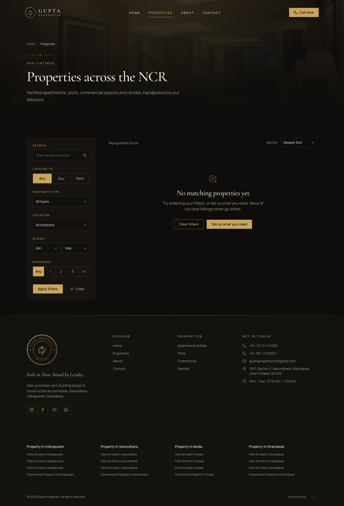
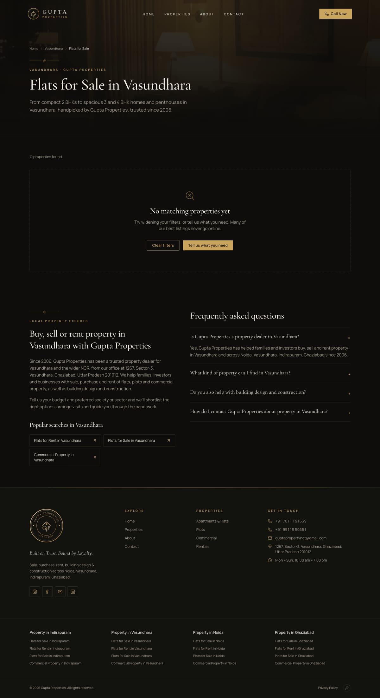
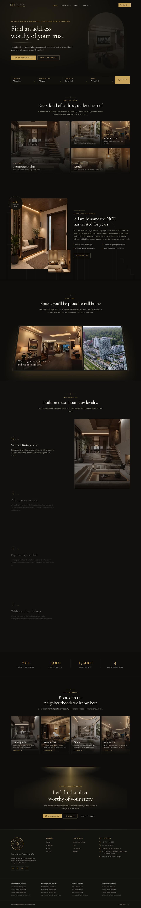
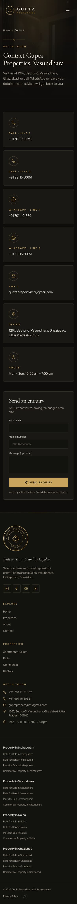
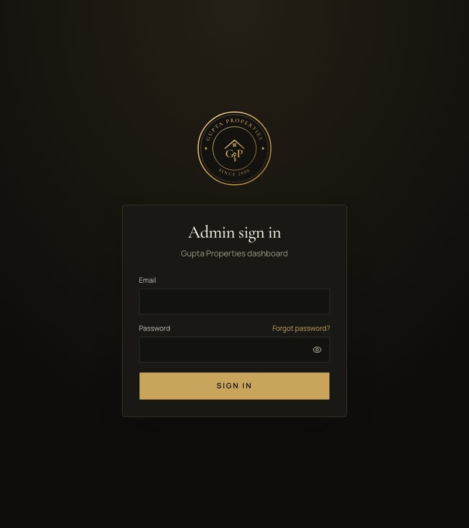

<div align="center">


# Gupta Properties

*Built on Trust. Bound by Loyalty.*

A premium real estate website and admin panel for **Gupta Properties**, a property dealer in Vasundhara, Ghaziabad, serving Vasundhara, Indirapuram, Noida and Ghaziabad since 2006.

**[Visit the live website →](https://gupta-properties-xi.vercel.app)**

</div>

---

## Screenshots

### Desktop


<table>
  <tr>
    <td width="50%"><p align="center"><sub>Property listings with filters</sub></p></td>
    <td width="50%"><p align="center"><sub>Local search page: Flats for Sale in Vasundhara</sub></p></td>
  </tr>
</table>

<details>
<summary><b>Full homepage (desktop)</b></summary>
<br />

</details>

### Mobile

<table>
  <tr>
    <td align="center" width="33%"><br /><sub>Homepage</sub></td>
    <td align="center" width="33%"><br /><sub>Contact page</sub></td>
    <td align="center" width="33%"><br /><sub>Admin sign in</sub></td>
  </tr>
</table>

<details>
<summary><b>Full homepage (mobile)</b></summary>
<br />
<p align="center"></p>
</details>

---

## About the website

A dark, gold-accented design built to feel premium on every screen, from phones to large desktops, while staying fast. Visitors can browse and search properties and contact the team instantly. The owners manage all listings and site content from a private admin panel, with no code changes needed.

## Features

### For visitors
- **Homepage**: video hero, property search bar, property types, featured listings, about, showcase, why choose us, stats, areas served, client testimonials and a contact banner.
- **Property search**: filter by buy/rent, type (flats, plots, commercial), location, budget and bedrooms; sort by price or newest; filters live in the URL so results can be shared.
- **Property pages**: swipeable photo gallery with full-screen zoom, key facts, amenities, video tour (YouTube or uploaded), Google Maps location, similar properties and a sticky contact card.
- **Instant contact**: Call and WhatsApp buttons everywhere, with a choice of two numbers, plus an enquiry form that is saved and emailed to the team.
- **Area pages**: a page for each locality (e.g. Vasundhara, Indirapuram) and for popular searches such as *Flats for Sale in Vasundhara* or *Plots for Sale in Ghaziabad*, each with a local guide and FAQs.
- **Save favourites**: visitors can heart properties (stored in their browser, no login needed).
- **About, Contact, Privacy** and a branded 404 page.

### For the team (admin panel at `/admin`)
- Secure email and password sign-in for approved admins only, with password reset.
- **Dashboard**: live listing counts, new enquiries and one-click removal of sample content.
- **Properties**: add, edit, duplicate, publish or unpublish, mark Sold or Rented, feature on the homepage and drag to set the homepage order.
- **Photo uploads**: drag and drop up to 20 photos, automatically compressed, with crop, reorder, cover photo and descriptions.
- **Rich descriptions**, amenities, map pin from a Google Maps link, YouTube or uploaded video.
- **Trash**: deleted listings can be restored for 30 days.
- **Enquiries inbox**: filter by status and reply on WhatsApp or by phone in one tap.
- **Site content**: edit contact details, homepage text, about section, stats, social links, testimonials and areas.

### Search engine optimisation
- Keyword-focused titles, descriptions and headings for Vasundhara, Indirapuram, Noida and Ghaziabad.
- Structured data for the business (address, phones, hours), each listing, breadcrumbs and FAQs.
- Automatic sitemap, robots rules and branded share previews for WhatsApp and social media.
- Lighthouse (mobile): **SEO 100** and **Accessibility 100** on audited pages.

### Performance and accessibility
- Pages are pre-rendered and served from a CDN; photos are pre-sized and lazy-loaded.
- Videos load only when visible and are skipped for data-saver and reduced-motion users.
- Animations use only transform and opacity; layout shift is zero on audited pages.
- Keyboard navigation, visible focus states and screen-reader labels throughout.

## Tech stack

| Area | Technology |
|---|---|
| Framework | Next.js 16 (App Router, Cache Components), React 19, TypeScript |
| Styling | Tailwind CSS v4, shadcn/ui components, custom premium effects |
| Database, login and file storage | Supabase (Postgres with Row Level Security, Auth, Storage) |
| Email alerts | Gmail SMTP via Nodemailer |
| Hosting and analytics | Vercel, Vercel Analytics and Speed Insights |
| Scheduled maintenance | GitHub Actions (daily keep-alive and Trash clean-up) |

## Project structure

```
src/
  app/(site)/        Public pages: home, properties, property detail, areas, about, contact
  app/admin/         Admin sign-in and panel
  app/api/cron/      Daily maintenance endpoint
  components/        Site, home, listing, property, admin and shared UI
  lib/               Data access, SEO helpers, validation, utilities
supabase/            Database schema, security policies and starter content
public/media/        Optimised videos and images
design/              Brand assets and design references
```

## Running locally

```bash
npm install
cp .env.example .env.local   # then fill in the values
npm run dev                  # http://localhost:3000
```

Environment variables are documented in [`.env.example`](.env.example). Database setup is in [`supabase/migrations`](supabase/migrations) and [`supabase/seed.sql`](supabase/seed.sql).

---

<div align="center">
<sub>© Gupta Properties · 1267, Sector-3, Vasundhara, Ghaziabad, Uttar Pradesh 201012 · +91 70111 91639 / +91 99115 50651</sub>
</div>
